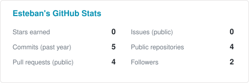
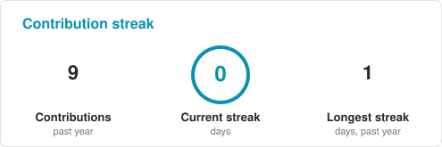
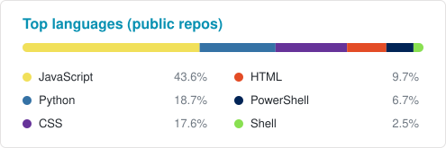

# Hi, I'm Esteban Flores 👋

**Senior Frontend Engineer · eCommerce & CMS specialist**

Building fast, accessible commerce and CMS front ends with React, Angular, and TypeScript.

---

## About me

I'm a senior frontend engineer with 10+ years across frontend engineering, QA, and business analysis, based in Quito, Ecuador. I lead enterprise B2B commerce builds on Optimizely using React, Angular, and TypeScript.

I started in QA and business analysis, which is why I care about edge cases, accessibility, performance, and code other developers enjoy working with. I work directly with clients to turn business needs into implementation plans, and I mentor developers through code reviews and architecture discussions.

**Currently**

- 🛒 Leading frontend for enterprise B2B commerce implementations
- 🧩 Designing reusable component libraries and scalable frontend architectures
- 🤖 Integrating AI-assisted development workflows to speed up delivery and documentation

---

## Tech stack

**Languages**

**Frontend**

**Commerce, CMS & platforms**

**Backend & data**

**Quality & tooling**

---

## GitHub activity

<!-- Cards are generated by .github/workflows/readme-stats.yml and committed to ./profile/ -->

<picture>
  <source media="(prefers-color-scheme: dark)" srcset="./profile/stats-dark.svg">
  
</picture>
<picture>
  <source media="(prefers-color-scheme: dark)" srcset="./profile/streak-dark.svg">
  
</picture>

<picture>
  <source media="(prefers-color-scheme: dark)" srcset="./profile/top-langs-dark.svg">
  
</picture>

---

Most of my work is for clients on private systems, so this profile only shows a slice of it.
See the full picture at **[estebanfloresf.com](https://www.estebanfloresf.com)**.

